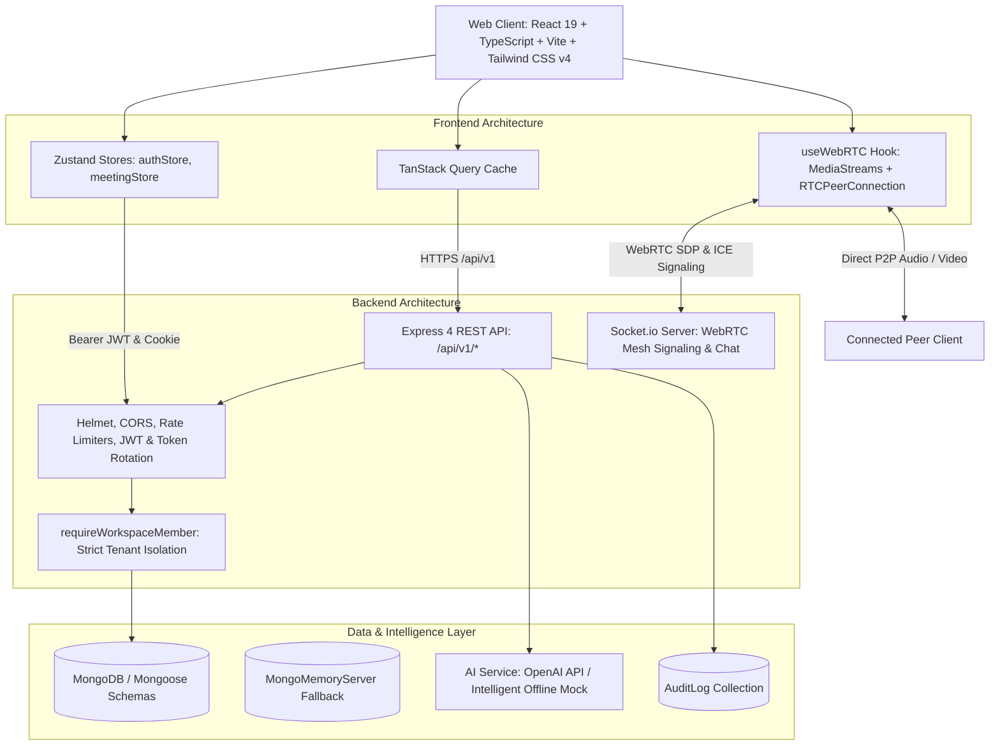

# IntellMeet — AI-Powered Enterprise Meeting & Collaboration Platform

[](https://github.com/your-org/intellmeet/actions/workflows/ci.yml)
[](https://nodejs.org/)
[](https://opensource.org/licenses/MIT)

**IntellMeet** is an enterprise-grade meeting and collaboration platform that unifies real-time WebRTC audio/video conferencing, AI meeting summaries, structured action-item extraction, and an integrated Kanban project board into a secure, multi-tenant workspace architecture.

---

## Key Highlights

- 📹 **Peer-to-Peer WebRTC Audio/Video**: Low-latency video conferencing with camera/mic controls, screen sharing, active speaker detection, and automatic STUN signaling via Socket.io.
- ⚡ **Zero-Config Local Development**: Automatically connects to external MongoDB or transparently spins up an in-memory database fallback (`mongodb-memory-server`) with zero manual setup.
- 🤖 **AI Meeting Intelligence**: Synthesizes structured executive summaries (Overview, Key Decisions, Discussion Highlights, Unresolved Questions, Next Steps) and extracts actionable deliverables. Compatible with OpenAI GPT-4o-mini and an intelligent zero-cost offline mock engine.
- 📋 **Integrated Kanban Project Management**: Convert meeting action items into project tasks with 1 click. Drag-and-drop / column movement across `TODO`, `IN_PROGRESS`, `IN_REVIEW`, and `DONE` with real-time assignment notifications.
- 🛡️ **Multi-Tenant Security Architecture**: OWASP-aligned security with strict workspace isolation enforced on every query, cryptographic refresh token rotation with family reuse attack detection, and an explicit participant consent gate before any recording or AI processing.
- 📊 **Enterprise Analytics**: Real-time KPI dashboards, meeting volume trends, task completion velocity, and CSV export.

---

## System Architecture



---

## Project Structure (Monorepo)

```
intellmeet/
├── apps/
│   ├── api/                     # Node.js + Express + TypeScript Backend
│   │   ├── src/
│   │   │   ├── config/          # Environment validation & DB connection with fallback
│   │   │   ├── controllers/     # REST controllers (auth, meetings, tasks, etc.)
│   │   │   ├── middleware/      # Auth, tenant isolation, rate limiters, error handling
│   │   │   ├── models/          # 15 Mongoose schemas with compound tenancy indexes
│   │   │   ├── routes/          # Express API route modules
│   │   │   ├── services/        # Business logic, AI engine, WebRTC chat, analytics
│   │   │   ├── sockets/         # Socket.io signaling, presence & room state
│   │   │   ├── __tests__/       # Vitest + Supertest integration & security tests
│   │   │   ├── app.ts           # Express application bootstrap
│   │   │   ├── server.ts        # Server entrypoint with graceful shutdown
│   │   │   └── seed.ts          # Database demo seeder
│   │   └── Dockerfile
│   └── web/                     # React 19 + TypeScript + Vite Frontend
│       ├── src/
│       │   ├── components/      # VideoGrid, ParticipantTile, MediaControls, Modals
│       │   ├── hooks/           # useWebRTC peer connection management
│       │   ├── pages/           # Landing, Dashboard, Lobby, Meeting Room, Kanban, etc.
│       │   ├── services/        # Centralized ApiClient with auto-refresh
│       │   ├── stores/          # Zustand authStore and meetingStore
│       │   ├── App.tsx          # Router configuration with protected routes
│       │   └── index.css        # Tailwind CSS v4 design tokens
│       ├── nginx.conf           # Production SPA & reverse-proxy configuration
│       └── Dockerfile
├── packages/
│   └── shared/                  # Domain enums, interfaces, and Zod validation schemas
├── .github/workflows/ci.yml     # Automated CI testing and build pipeline
├── docker-compose.yml           # Production & local Docker services setup
├── .env.example                 # Environment configuration guide
└── README.md
```

---

## Getting Started

### Prerequisites

- **Node.js**: `v20.0.0` or higher (Tested on Node `v24.x`)
- **npm**: `v10.x` or higher
- **MongoDB**: (Optional) Standard local daemon, Docker container, or MongoDB Atlas. If absent, the application transparently starts an in-memory database instance.

### 1. Installation

Clone the repository and install all monorepo dependencies:

```bash
cd intellmeet
npm install
```

### 2. Configure Environment

Copy the example environment configuration:

```bash
cp .env.example apps/api/.env
```

Default variables are pre-configured to run out-of-the-box in `mock` AI mode. To connect Groq (ultra-fast LLM inference) or OpenAI:
```env
# For Groq (Recommended for ultra-fast meeting intelligence)
AI_PROVIDER=groq
GROQ_API_KEY=gsk_...
GROQ_MODEL=openai/gpt-oss-120b

# Or for OpenAI
AI_PROVIDER=openai
OPENAI_API_KEY=sk-...
```

### 3. Seed Realistic Demo Data

Populate demo accounts, an enterprise workspace, meetings with transcripts & AI summaries, and Kanban tasks:

```bash
npm run seed --workspace=@intellmeet/api
```

**Seeded Demo Credentials:**
- **Email**: `alex.chen@intellmeet.com`
- **Password**: `Password123!`
- **Workspace**: Acme Technologies

### 4. Run Locally

Start the Backend API and WebRTC Server (Port `5000`):
```bash
npm run dev --workspace=@intellmeet/api
```

In a separate terminal, start the Frontend Web Application (Port `5173`):
```bash
npm run dev --workspace=@intellmeet/web
```

Or start both concurrently:
```bash
npm run dev:all
```

Open [http://localhost:5173](http://localhost:5173) in your browser.

---

## Running with Docker Compose

To run the entire platform with MongoDB, Redis, API, and Nginx Web front-end via Docker:

```bash
docker-compose up --build
```

- **Frontend**: [http://localhost](http://localhost)
- **Backend API**: [http://localhost:5000](http://localhost:5000)
- **Health check**: [http://localhost:5000/api/v1/health](http://localhost:5000/api/v1/health)

---

## Testing

Run the full integration, security, and authorization test suite using Vitest and Supertest:

```bash
npm run test --workspace=@intellmeet/api
```

The test suite validates:
1. Health endpoint status & telemetry
2. User registration and automatic workspace setup
3. Authentication credentials & password hashing
4. Multi-tenant workspace isolation (verifying cross-workspace data leakage is blocked with `403 Forbidden`)
5. Meeting scheduling and WebRTC room access
6. AI meeting intelligence summary and action items extraction
7. Participant consent gate enforcement
8. Kanban task lifecycle and status state changes
9. Real-time analytics aggregation and CSV report exports

---

## WebRTC Architecture & Production Scaling

### Signaling Flow
1. **Join**: Attendee emits `meeting:join` with meeting identifier and display name.
2. **Room State**: Server replies with `meeting:room-state`, broadcasting `meeting:participant-joined` to other room members.
3. **P2P Mesh**: The joining client generates an SDP Offer for each existing participant via `meeting:signal`. Remote peers respond with an SDP Answer and trickle ICE candidates.
4. **Media Controls**: Audio/video track state changes and screen share toggles are coordinated via `meeting:state-updated` and `meeting:screen-share`.

### STUN / TURN Requirements
- **Standard NAT**: Default public STUN servers (`stun:stun.l.google.com:19302`) negotiate peer connections directly.
- **Symmetric NAT / Strict Enterprise Firewalls**: A TURN relay server (such as Coturn) is required when endpoints cannot negotiate direct UDP packets. Configure `TURN_URL`, `TURN_USERNAME`, and `TURN_CREDENTIAL` in environment variables.

### SFU Scalability Path
Peer-to-peer mesh WebRTC is optimized for interactive rooms of up to 6–8 active video participants ($N \times (N-1)$ connections). For large enterprise webinars (100+ participants), integrate a Selective Forwarding Unit (SFU) such as **LiveKit** or **mediasoup**, where peers send a single upstream video track to the media server.

---

## REST API Documentation (`/api/v1`)

| Method | Endpoint | Description | Auth Required |
|---|---|---|---|
| `GET` | `/health` | Server health check and provider info | No |
| `POST` | `/auth/register` | Register new account and workspace | No |
| `POST` | `/auth/login` | Authenticate and issue token pair | No |
| `POST` | `/auth/refresh` | Refresh access token with rotation | No (Cookie/Body) |
| `POST` | `/auth/logout` | Revoke current refresh token family | Yes |
| `GET` | `/auth/me` | Fetch authenticated user profile | Yes |
| `GET` | `/workspaces` | List accessible workspaces for user | Yes |
| `POST` | `/workspaces` | Create a new team workspace | Yes |
| `GET` | `/workspaces/:id/members` | List members in workspace | Yes (Member) |
| `POST` | `/workspaces/:id/invitations` | Invite colleague to workspace | Yes (Admin/Owner) |
| `GET` | `/meetings` | List meetings with status/search filter | Yes (Member) |
| `POST` | `/meetings` | Schedule a new meeting | Yes (Member) |
| `GET` | `/meetings/:id` | Get meeting details and access settings | Yes (Member) |
| `PATCH` | `/meetings/:id` | Update meeting details or access | Yes (Host/Admin) |
| `POST` | `/meetings/:id/join` | Join meeting and obtain participant record | Yes / Guest |
| `POST` | `/meetings/:id/end` | End meeting for all participants | Yes (Host) |
| `GET` | `/meetings/:id/messages` | Retrieve persistent meeting chat history | Yes (Member) |
| `POST` | `/meetings/:id/messages` | Send in-meeting chat message | Yes (Member) |
| `POST` | `/meetings/:id/ai/process` | Trigger AI meeting summary & action items | Yes (Member + Consent) |
| `GET` | `/meetings/:id/summary` | Get AI summary, decisions, & action items | Yes (Member) |
| `PATCH` | `/meetings/:id/summary` | User edit and refinement of summary | Yes (Member) |
| `GET` | `/tasks` | List Kanban tasks with filters | Yes (Member) |
| `POST` | `/tasks` | Create task manually | Yes (Member) |
| `PATCH` | `/tasks/:id` | Update task status, priority, or owner | Yes (Member) |
| `DELETE` | `/tasks/:id` | Delete project task | Yes (Member) |
| `POST` | `/tasks/convert-action-item` | 1-Click convert AI item to Kanban card | Yes (Member) |
| `GET` | `/notifications` | List user in-app notifications | Yes |
| `PATCH` | `/notifications/read-all` | Mark all notifications as read | Yes |
| `GET` | `/analytics/overview` | Meeting volume and task velocity metrics | Yes (Member) |
| `GET` | `/analytics/export` | Download authorized workspace CSV report | Yes (Member) |

---

## Real-Time Socket Events

| Event Name | Direction | Payload | Description |
|---|---|---|---|
| `meeting:join` | Client -> Server | `{ meetingId, fullName, isMuted, isCameraOff }` | Joins WebRTC room |
| `meeting:room-state` | Server -> Client | `{ participants, you }` | Returns active room roster |
| `meeting:participant-joined` | Server -> Client | `{ socketId, fullName, role }` | Notifies peers of new participant |
| `meeting:signal` | Bidirectional | `{ toSocketId, fromSocketId, signal }` | WebRTC SDP offer/answer/ICE |
| `meeting:state-updated` | Client -> Server | `{ meetingId, isMuted, isCameraOff, isHandRaised }` | Toggles media track states |
| `meeting:screen-share` | Client -> Server | `{ meetingId, isSharing }` | Starts/stops screen sharing |
| `meeting:chat` | Bidirectional | `{ meetingId, message, senderName }` | In-meeting chat message |
| `meeting:participant-left` | Server -> Client | `{ socketId, fullName }` | Cleans up peer connection |
| `notification:new` | Server -> Client | `{ id, title, message, type }` | Real-time personal notification |

---

## License

This project is licensed under the MIT License. See [LICENSE](LICENSE) for details.
